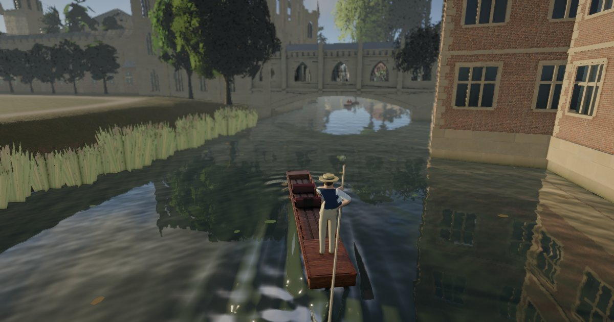

# Cambridge Punting

A browser game about punting along the Backs of the River Cam, in Cambridge.

**[Play it at tonytsoi.github.io/cambridge-punting](https://tonytsoi.github.io/cambridge-punting/)**: nothing to install.

Punt the real Backs, from the Mill Pond under all nine bridges to past Magdalene Bridge, beside King's College Chapel, Clare, Trinity and St John's. The river, the banks, 1,600 buildings and 10,600 trees stand where OpenStreetMap and the Environment Agency's LIDAR survey put them. Photographed skies light it at four times of day, or in the rain, and the water mirrors the scene and ripples in your wake.

## What there is to do

- **Learn to pole.** Plant the pole, push, and let go before it sticks in the mud; steer with the trailing pole, and duck under the low bridges.
- **Find 18 landmarks.** Each tells its story in under a hundred words, with its sources, and a journal keeps them.
- **Take photos.** Photo mode flies the camera free, with depth of field, filters and more.
- **Share the river** with other punts, ducks, swans and people on the bridges, and hear it all around you: the weir, birdsong, bells, and the echo under each bridge.

## How to play

- **Keyboard and mouse:** Space to pole, A and D to steer, Shift to duck, drag to look around, Esc for the menu. H shows every key.
- **Gamepad:** the right trigger poles, the left stick steers, and B ducks.
- **Touch:** on a phone or tablet held sideways, with the controls on screen. Add it to your home screen to play full screen.

It runs in a current Chrome, Edge, Firefox or Safari, on a computer, a phone or a tablet. The first start takes a few seconds while it prepares its graphics. On a laptop with two graphics chips, set your browser to use the faster one (on Windows: Settings → System → Display → Graphics → High performance).

**Accessibility:** Settings has Reduce motion, and Duck can be pressed once rather than held. The menus work by keyboard alone and meet WCAG 2.1 AA.

## About this repository

It holds only the built game, as the website serves it. The source is kept private.

## Copyright and credits

© 2026 Tony Tsoi. All rights reserved.

Map data © [OpenStreetMap](https://www.openstreetmap.org/copyright) contributors, under the Open Database Licence. Heights from the Environment Agency's LIDAR survey, under the Open Government Licence v3.0. Skies and textures from [Poly Haven](https://polyhaven.com), and recordings from [Freesound](https://freesound.org), all CC0. The software it includes keeps its own licences, listed in full in [notices.html](notices.html).
